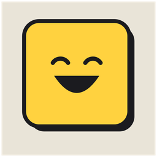
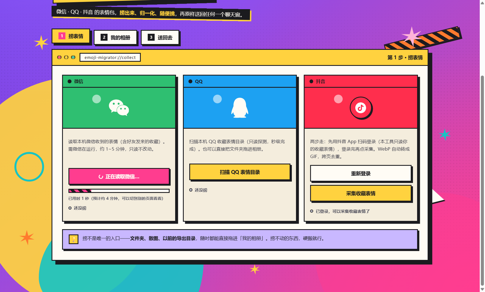

<div align="center">



# 把我的表情还回来

**GIVE ME BACK MY MEMES**

把散落在微信、QQ、抖音里的收藏表情，整理成一份干净的图库。

[](LICENSE)
[](#开发)
[](pyproject.toml)
[](#快速开始)

</div>



---

## 为什么需要它

你的表情包大概是这样的：微信里攒了几百个，翻起来要滑很久；QQ 收藏里还有一批，
文件名和格式乱七八糟；抖音收藏的表情只能在 App 里用，导不出来。

想整理一遍？三个平台的目录结构、命名规则、体积限制都不一样，手动挪一晚上也挪不完。
还经常遇到「这个文件明明能看，导入平台却说格式不支持」——因为它的后缀是错的。

这个工具就是干这件事的。

## 能做什么

| 能力 | 说明 |
| --- | --- |
| **认格式** | 按文件真实字节判断类型，不信后缀。很多表情声明 `.jpg` 其实是 `.gif` |
| **修后缀** | 把后缀改成正确的，平台导入才不会失败 |
| **去重** | 感知哈希比对，同一张表情存了五份只留一份 |
| **三端采集** | 微信 / QQ / 抖音，各走各的路径（见下） |
| **相册式整理** | 贴纸册页按平台、分类筛选，支持搜索与多选 |
| **导出** | 落到 `emoji-migrator-out/时间戳/`，每次新建目录，不覆盖上次 |

整个界面是一个三步流程：**添加表情来源 → 整理我的表情 → 导出到目标端**。

## 三个平台怎么读

| 平台 | 路径 | 耗时 |
| --- | --- | --- |
| **QQ** | 注册表找到表情目录，直接读明文文件 | 秒级 |
| **微信** | 从微信本地缓存读取你的收藏表情，在内存中还原成标准图片后转 GIF。不写微信目录、不注入进程、密钥用完即弃 | 约 1–5 分钟 |
| **抖音** | App 扫码登录后，调它自己的收藏列表接口，WebP 转 GIF，跨页去重 | 取决于收藏量 |

三个入口之外还有兜底：文件夹、散图、上次的导出目录，随时能直接拖进「我的相册」。

## 快速开始

### 用现成的 exe

到 **[Releases](../../releases/latest)** 下载 `give-me-back-my-memes-v0.1.0.exe`，双击即可。

> GitHub 的 release 文件名不支持中文，所以用了英文名。下载后可以自行改名，功能不受影响。

单文件程序，不写注册表、不装服务。**删除这一个文件就是完整卸载**。
第一次启动会在系统临时目录里解开自己，等几秒属正常。

### 从源码跑

```bash
git clone https://github.com/Abird64/give-me-back-my-memes.git
cd give-me-back-my-memes
python -m venv .venv
.venv/Scripts/python.exe -m pip install -e ".[dev]"
.venv/Scripts/python.exe -m emoji_migrator.webui      # 图形界面
.venv/Scripts/python.exe -m emoji_migrator.cli --help # 命令行
```

Windows 用户也可以直接双击 `scripts/启动新版前端.bat`。

命令行能力：

```bash
emoji-migrator scan       <目录>              # 只读：列出后缀与真实格式不一致的文件
emoji-migrator normalize  <目录> -o <输出>    # 嗅探 → 修后缀 → 去重 → 正确性守门
emoji-migrator collect-weixin  -o <输出>      # 从微信导出表情（需微信在运行）
emoji-migrator collect-douyin  -o <输出>      # 从抖音导出收藏（需先在 GUI 登录）
```

## 它不做什么

这条边界是刻意划的，也是这个项目能长期存在的前提：

- **不修改任何原文件**。所有输出都是副本，你的素材一个字节都不会动
- **不注入微信进程**，不写微信目录，密钥只在内存里用一次
- **不联网上传**。没有任何遥测、账号系统、云端处理
- **不替你点平台的导入按钮**。最后一步按内置图文指引手动做，一分钟搞定

## 使用须知

本工具只处理**你本人账号**下、已经缓存在你这台电脑上的表情文件。
它不提供批量爬取他人内容、破解他人账号或入侵系统的能力。

各平台的服务条款对第三方读写本地数据可能有各自的限制，使用前请自行判断是否接受；
因使用本工具产生的后果由使用者承担。

## 项目结构

```
src/emoji_migrator/     核心包
├── webui.py + webui/   图形界面（PySide6 壳 + 内嵌 HTML/CSS/JS）
├── cli.py              命令行入口
├── sniff.py            格式嗅探（按真实字节）
├── dedupe.py           感知哈希去重
├── normalize.py        后缀修正与归一化
├── collect_flow.py     采集编排
├── wx*.py              微信链路（目录探测 / 内存取 seed / 解密 / 编排）
├── douyin_*.py         抖音链路（扫码登录 / 收藏列表 / WebP 转 GIF）
├── qqdir.py            QQ 表情目录探测
└── guard.py            合规基线（被禁 API 清单的唯一权威副本）

tests/                  625 个测试，含合规静态扫描
docs/                   方案归档与架构说明
design-prototype/       界面设计与图标源文件
scripts/                本地启动脚本
fixtures/               测试素材生成器（不含任何真实用户数据）
```

## 开发

```bash
.venv/Scripts/python.exe -m pytest tests -q        # 必须全绿
.venv/Scripts/python.exe -m ruff check src tests   # 必须 All checks passed
```

两条闸门不是摆设：

- `tests/test_compliance.py` 静态扫描 `src/`，断言内存写入、远程线程、DLL 注入同族
  API 标识符**零出现**
- `tests/test_packaging.py` 守护打包文档与产物名的一致性——`*.spec` 不入库，
  `docs/07-打包发布与验证.md` 是唯一的耐久真相源

工程约定（模块依赖方向、写入范围、环境坑）都在 [`AGENTS.md`](AGENTS.md)，动代码前先读。

## 许可

本项目采用 [MIT 许可证](LICENSE) © 2026 Abird

随包分发的第三方组件各自保留原许可，全文与组件清单见 [`docs/licenses/`](docs/licenses/)：

| 组件 | 许可 | 说明 |
| --- | --- | --- |
| PySide6 / Shiboken6 | **LGPL-3.0** | 分发时必须随附许可证全文，见 `docs/licenses/NOTICE.md` |
| `f2`（abogus 签名实现） | Apache-2.0 | vendor 代码，逐字未改，provenance 见文件头 |
| `gmssl` | BSD | vendor 代码，SM3 哈希辅助函数 |
| Pillow / imageio / numpy / pycryptodome | 各自原许可 | 全文在 `docs/licenses/` |
